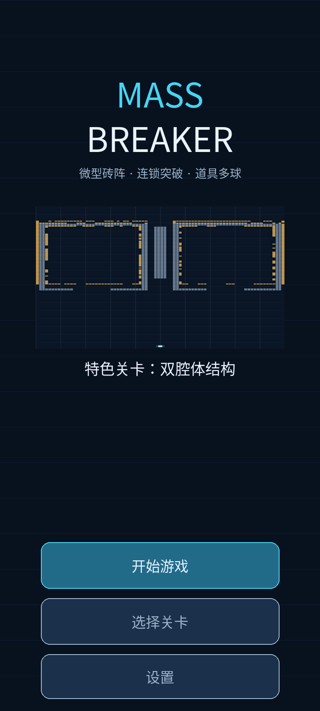
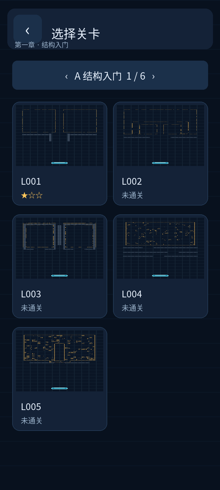
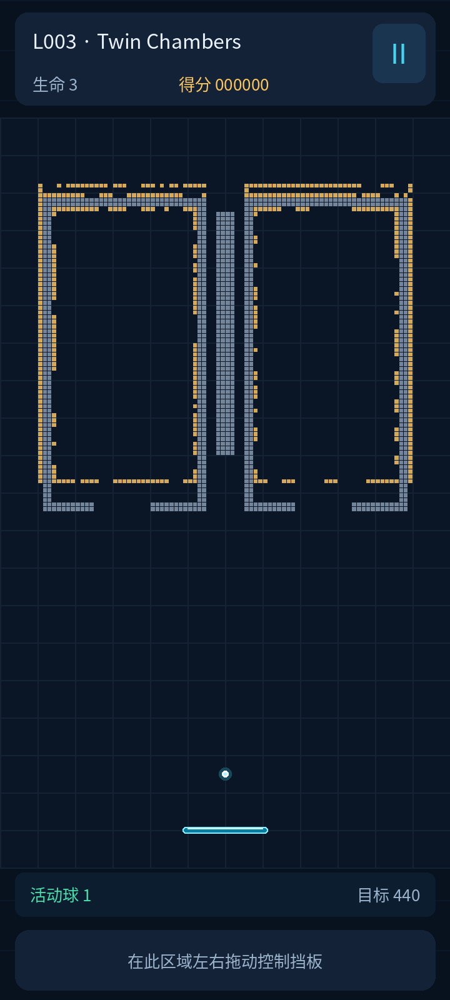
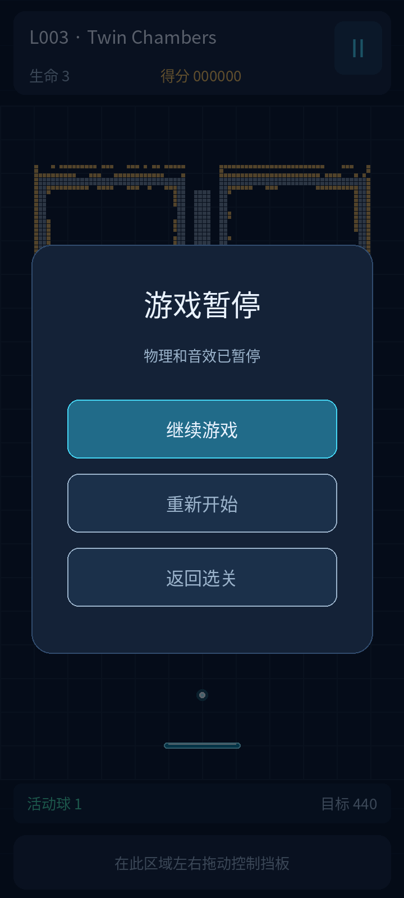
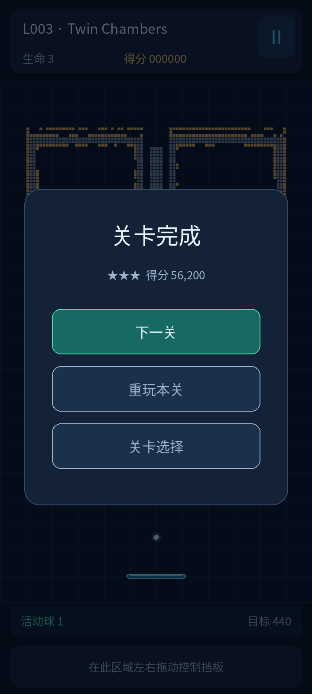
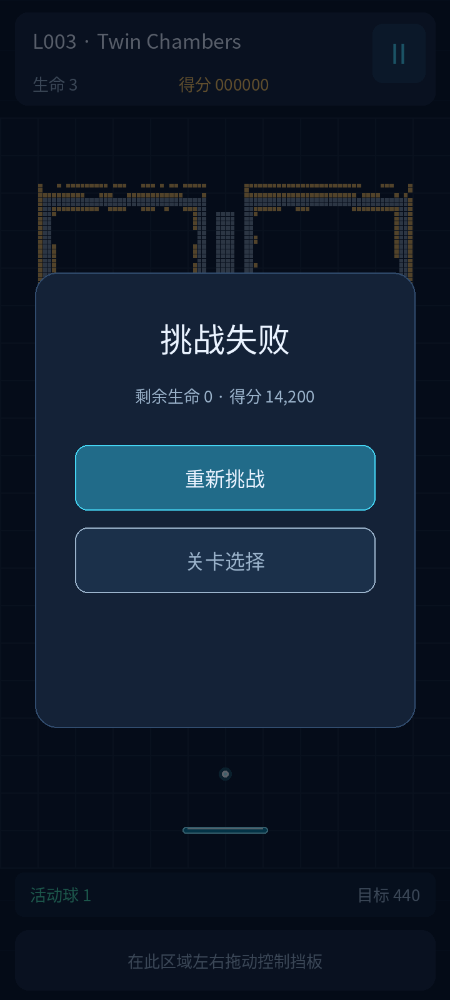
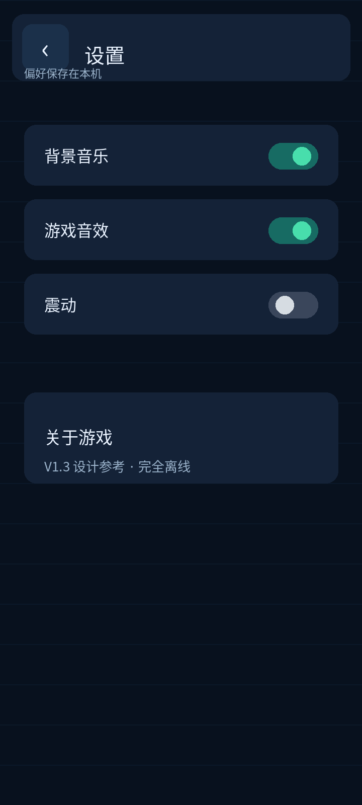
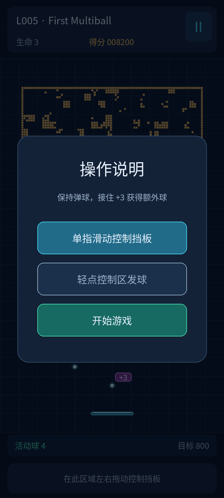

# 界面与交互详细设计（UI / UX）

**文档编号** MB-UI-010｜**适用** Android 竖屏 / Windows 调试端

**状态** 可实施的界面规格与设计线框；**不是实际运行截图**。

## 1. 设计范围与导航

V1 页面：主页、关卡选择、游戏主界面、暂停面板、成功结算、失败结算、设置页、首次操作提示（2 步）。没有账户、商店、广告、排行榜或观看加速入口。Windows 与 Android 使用同一 UI 状态逻辑，鼠标仅为桌面调试输入。

```text
首次启动 ─→ 操作提示 ─→ L001（开始前准备）
再次启动 ─→ 主页 ──┬── 继续游戏 ───────→ 已解锁进度对应关卡
                   ├── 选择关卡 ───────→ 章节 / 关卡 ──→ 游戏
                   └── 设置
游戏 ── 暂停 ───┬── 继续
               ├── 重新开始 ───→ 当前关卡重置
               └── 返回选关 ───→ 关卡选择
游戏 ── 通关 ───┬── 下一关（L030 后隐藏）
               ├── 重玩本关
               └── 关卡选择
游戏 ── 失败 ───┬── 重新挑战
               └── 关卡选择
```

首次启动的操作提示不要求把完整游戏塞进教程：第 1 步演示拖动挡板；第 2 步介绍 `+3` 道具（到 L005 第一次实际出现时可再次提示一次）。无网络权限依赖。

## 2. 设计画布、适配与单位

- **设计参考尺寸：360 × 800 逻辑 UI 单位**。提供的 PNG 以 2 倍像素密度绘制；程序不能把图片像素值当作设备物理像素写死。
- SDL3 提供窗口像素尺寸、输入坐标及安全区域；先得到扣除状态栏/挖孔/导航手势影响的 `safeRect`，再统一映射设计单位。用于触控命中的矩形与视觉矩形必须采用同一变换。
- **游戏物理世界固定为 24 × 40 世界单位**；关卡网格 96 × 160、砖格 0.25 世界单位，不能因屏幕比例变动而改变物理格数。
- HUD 可视区域参考高 74 UI 单位；底部操作区可视框高 48 UI 单位、实际手势命中区域 `y=736..800` 高 64 UI 单位；中间可用空间按比例绘制世界：`s = min(usableWidth/24, usableHeight/40)`，左右／上下剩余区域留暗底衬托，禁止裁掉砖阵或挡板。
- 在 360×800 参考安全区域内可容纳 360×600 的游戏世界。对于更短的 16:9 屏幕，应等比缩小世界而非挤占安全区。对于极窄设备可让 HUD 的次要信息换行或简化。
- 界面内部使用独立 UI 坐标，不直接拿世界坐标放按钮；游戏世界坐标只通过 `WorldViewport` 转换。
- 触控控件实际可点击区建议至少约 44 × 44 UI 单位；用户可读内容不应小于 12 UI 单位的设计字号。刘海、手势区域内不放重要元素。

## 3. 视觉与组件规范

| Token | 值 | 用途 |
|---|---|---|
| `bg/base` | `#08111E` | 全屏深色背景 |
| `surface/card` | `#142237` | 面板、菜单卡片 |
| `surface/raised` | `#1B304A` | 二级按钮、设置控件 |
| `text/primary` | `#EAF3FF` | 主文字；**以 `assets/config/visual.json.colors.textPrimary` 为唯一权威** |
| `text/secondary` | `#9BB3CB` | 说明、次要信息 |
| `accent/cyan` | `#45D5F3` | 主 CTA、挡板、暂停强调 |
| `accent/yellow` | `#FFC65A` | 普通微砖、分数、星级 |
| `status/success` | `#48DEAC` | 通关、增球反馈 |
| `status/error` | `#FF836A` | 失败、警示 |
| `wall/solid` | `#73859A` | 不可破坏墙 |

- 默认中文：选用允许在应用中分发的开源 CJK 字体，统一小字字形缓存；字库、字体许可证随发布资源管理。原型图所用字体不包含在交付包里。
- 标题建议 24–30，一级按钮 16–18，信息 13–15，辅助 12；字号会随用户系统字体和可读性评估微调，不能在一行强行塞入过长文案。
- 主要按钮高度 52、圆角 14；面板圆角 12–20。弱化非必要全屏光效，微砖间距与球路径应始终可辨。
- 砖块颜色**并非游戏玩法的唯一标识**：固定墙为灰蓝实格；加固砖用亮边/剩余 HP 层次；微型 `B` 砖以紫色+中心亮点区分，**不在单格内强行写不可读的 `+3`**；`+3` 文字出现在下落的装饰道具牌上。详见 [`14_VISUAL_DESIGN_AND_FEEDBACK.md`](14_VISUAL_DESIGN_AND_FEEDBACK.md)。
- V1 只提供轻量命中动画、球残影（可选）、通关弹出、按钮按下反馈；当弹球增多时，应合并密集命中音效及粒子事件，避免视觉遮挡。

## 4. 八种界面规格

> **当前视觉基线**：[8 页设计总览](../design/ui/final/all_8_final_screens.png)、[L003 微砖参考](../design/ui/final/03_gameplay.png)、[L028 多球参考](../design/ui/final/03_gameplay_multiball.png)。砖/墙位置来自当前 JSON，球位与 HUD 为设计示意，不是运行截图。

### UI-01 首页



- **布局**：顶部品牌区（LOGO、短副标题）；中部特色关卡静态预览；下方垂直主操作区：`继续游戏` / `选择关卡` / `设置`。
- **行为**：`继续游戏` 跳转到最近未通关且已解锁的关卡；首次没有进度时标为 `开始游戏` 并进入 L001；点击 `选择关卡` 进入章节页。
- **返回**：Android 返回键在主页不意外退出，可遵循系统退出行为或二次确认（最终采用系统常规行为）。
- **状态**：资源加载失败显示简短可恢复错误，不渲染空白屏；离线不展示登录入口。

### UI-02 关卡选择



- **布局**：顶部返回与页名；章节标题/进度提示；两列关卡卡片（小型真实关卡缩略图、Lxxx、中文名、最高星级）。章节可水平切换或按页签切换，单章 5 关，屏幕较矮时竖直滚动。
- **点击状态**：已解锁可进入，锁定卡片置灰且不得进入；已完成显示最高星级和最佳分数的详情或提示。
- **空状态**：无存档时仅 L001 解锁；无论如何应允许进入第一关。
- **返回**：返回首页；触控命中区与卡片视觉范围一致。

### UI-03 游戏主界面（核心）



| 区域 | 参考位置（360×800） | 必须内容 / 交互 |
|---|---|---|
| 顶部 HUD | `y=10–84` | `Lxxx` 关名、生命、得分、暂停按钮；活动球和剩余目标也可放在场景下方 |
| 世界渲染区 | 参考 `y=94–694` | 固定 24×40 等比例世界，微砖、固定墙、弹球、挡板、掉落道具 |
| 球数/目标提示 | 世界下方的可用边栏 | `活动球 N`、`剩余目标 M`，值由实际会话数据提供 |
| 操作区 | 视觉 `y=744–792`，命中 `y=736–800` | 滑动控制挡板；READY 状态轻点此区域发球（按下至抬起位移小于 8 UI 单位） |

- **输入优先级**：系统挂起/焦点 → 模态对话框 → 暂停面板/导航 → HUD 暂停按钮 → 世界操作。模态出现清除已捕获 finger ID；旧手指抬起不得发球，第二手指不劫持已有拖动。算法和这里完全统一。
- **拖动模型**：以第一次按下时的挡板中心为基准，累加手指水平位移（非将挡板立即跳到手指正下方）；挡板在世界边界内 clamp。松手不自动把挡板复位。
- **准备发球**：首颗球附着挡板；READY 状态控制区单指轻点（位移小于 8 UI 单位）发球，拖动只控制挡板；播放中不重复发球，也没有加速观看功能。
- **暂停/后台**：按钮暂停，显示 UI-04；退后台则物理与音频暂停，返回前台后显示暂停界面，让玩家主动继续。
- **数据**：计分、目标、活动球、生命只由 `GameSession` 推送，禁止 UI 自行计算。
- **可辨识性**：白色球始终高于砖块破碎特效图层；同场多球不依赖色彩区分单个球。

### UI-04 暂停面板



- 游戏画面保持原状态并叠加深色半透明遮罩；面板包含 `继续游戏`、`重新开始`、`返回选关`。`frame.currentTick.hud.pauseReason` 为 `SimulationOverload` 时在面板标题下显示“运行暂时跟不上，游戏已暂停”；普通用户暂停不显示此警示。暂停前积压时间不随 Resume 补算，画面保持已执行的最后一个完整物理步。
- 点击“继续”由**独立的显示帧控制通道**立即将 `PAUSED` 还原为之前 `READY/PLAYING` 状态，清空本轮积累的物理时间，避免恢复时跳跃；不等待 fixed tick。重新开始和离开本关的确认弹窗优先拦截输入；确认后 `Retry/ExitToSelect` 也由控制通道立即执行。
- Android 返回键在暂停面板执行“继续”，返回键在游戏中执行“暂停”。

### UI-05 成功结算



- 展示通关、星级（按剩余生命数）、得分、剩余生命、`下一关`、`重玩本关`、`关卡选择`。
- 成绩持久化成功后再开放下一关跳转；存档失败显示重试提示而不是伪装保存成功。**T11 可在 T03 后并行完成真实文件读写；T10 优先接入真实 SaveResult，尚未就绪时可注入结果验证状态规则。正式字体和视觉由 T12 完成。**
- L030 完成后隐藏或改写 `下一关` 按钮为 `返回关卡`。

### UI-06 失败结算



- 展示失败原因（V1 仅生命耗尽，固定文案 `生命耗尽`）、`frame.currentTick.hud.score` 和 **`已破坏 {destroyedTargets} / {initialTargets}`**；这两个目标数由 `GameSession::snapshot()` 提供。UI 禁止自行累计 `BrickDestroyed`、计算第三份统计或沿用旧关卡数据。仅 `重新挑战` / `选择关卡`。
- 失败不回滚已解锁关卡；不强制观看广告或跳转外部页面。

### UI-07 设置



- 背景音乐、游戏音效、震动（如果设备支持）；关于游戏与版本号。
- 改动即时生效并写本地设置；音效关闭不得导致正在播放的音效延续；不支持震动的设备隐藏或禁用该项。
- 页面可从首页打开；以后如从暂停打开，应恢复至相同暂停状态。

### UI-08 首次操作提示



- 两步轻量提示：拖动挡板；`+3` 道具拾取。不要阻塞手势控制或引入长段教程。
- 重新安装或清除应用数据后再显示；用户可跳过，后续可在设置“帮助”查看简述（若实现帮助入口，应补充 UI 测试）。

## 5. 显示状态与异常路径

| 场景 | 行为 |
|---|---|
| 没有存档 | 首页按钮显示“开始游戏”；L001 已解锁 |
| 正在发球前 | 1 球附着挡板，操作区提示“点击发球” |
| 道具被接住 | 道具牌仍标示其**标称** `+3`，但拾取后的奖励弹字严格由同 `ItemId` 的 `BallsSpawned.value` 与 `overflowScore` 决定：新增 3/2/1/0 球对应不同文案，不固定写 `+3 球`；HUD 球数与总分同时更新 |
| 追赶超出预算 | 自动进入 `PAUSED` 并显示“运行暂时跟不上，游戏已暂停”，保留现有场景、生命与积分；提供继续、重新开始、返回选关，用户主动恢复后才继续物理 |
| 多球增加 | HUD 显示实际活跃球数，数字使用紧凑格式且不闪烁 |
| 游戏失去焦点 | 立刻暂停，不补偿后台时长 |
| 存档写入失败 | 明确错误提示，允许重试保存，不伪造“已保存” |
| 关卡 JSON 无法读取 | 可返回选关的错误页，并记录关卡 ID、错误码 |
| 页面缩放 | 按安全区域重新布局，禁止将关卡裁切或按钮压进系统手势区 |

### 5.1 实际奖励提示

道具牌显示标称 `+3`；拾取时 `ItemCollected` 只通知道具消失，随后同 ItemId 的 `BallsSpawned` 决定结果提示。所有补分由核心写入总分，UI 不通过分数差额反推奖励。两张道具分别提示，不将标称数相加冒充真实新增。

| `BallsSpawned.value` | `overflowScore` | 最终弹字（160ms） |
|---:|---:|---|
| 3 | 0 | `+3 球` |
| 2 | 50 | `+2 球 · +50 分` |
| 1 | 100 | `+1 球 · +100 分` |
| 0 | 150 | `球数已满 · +150 分` |

提示持续时间来自 `visual.json.effects.bonusPickupFlashMs`（默认 160ms）。安全暂停只使用既有暂停页；按 `frame.currentTick.hud.pauseReason` 显示原因，不增加页面或自行推断过载。

### 5.2 静态页面与显示调度

- READY 无输入不执行周期物理；拖动/轻点唤醒后在最近允许的显示工作处理一次准备步，手势规则不变。PLAYING 按固定物理步采样。
- 菜单、暂停、结算和教程没有交互或动画时按需重绘；有限动画完成后阻塞等待。静止期间不闪烁提示文字、不用周期重排制造 dirty。
- 控制、保存完成、窗口暴露与生命周期消息独立于呈现；没有周期绘制也要及时更新状态和安排一次必要重绘。后台停止图形提交，前台按当前状态恢复。
- UI 只在文本/布局/样式实际改变时更新缓存；释放 FramePacket 后不得保留其中引用，必要反馈转入自有有界状态。

## 6. UI 事件及 C++ 对接

```cpp
// ScreenId 由 UI 控制器定义，HUD 类型不在 UI 层重复定义。
enum class ScreenId { Home, LevelSelect, Gameplay, Pause, Win, Lose, Settings, Tutorial };
// 从 FramePacket 的唯一权威路径读取：
// ui.consume(frame.currentTick.hud, frame.events);
// currentTick.hud 的类型为算法 §7 中的 SessionSnapshot。
```

- UI 只读取 `FramePacket.currentTick.hud`（类型 `SessionSnapshot`）与本帧 `OrderedEvent`；失败页 `destroyedTargets/initialTargets` 必须由此快照直接提供。不定义第二份 `HudSnapshot`，不直接访问 `BrickField` 可写状态，也不按事件自行积累计数。
- `UI::hitTest()` 与物理世界输入映射统一接收 SDL 安全区域变换后的坐标。
- 页面转场和 `ControlCommand::Resume/Retry/Pause/ExitToSelect/Confirm/Cancel` 在**显示帧控制通道**触发，不依赖固定物理步；过场动效不得推进游戏物理时间。
- 文案资源按 key 集中管理（先中文；后续语言扩展不应要求修改菜单逻辑）。
- 公共事件名称、载荷及快照字段以 [算法 §7](12_CORE_ALGORITHMS.md) 为准；UI 不定义同义拾取事件。`SessionReset` 可在零 tick 帧交付；终态事件当帧切屏，不等待下一物理步。失球、通关或失败后不得继续执行旧累积时间。
- 多 tick 事件按顺序一次消费；HUD 读取当前快照，物体绘制读取同一 FramePacket 中的球/板/道具状态。暂停、后台、重试和换关的插值及事件清理规则见算法 §3.4。

## 7. UI 分阶段验收清单（T10 / T11 / T12）

**T10 — 页面与交互验收（真实资源/存档优先，未就绪时允许占位）：**

- [ ] T08/T09 已完成；API-02、BONUS-01 使用真实挡板反射、拾取与增球事件，只有 SaveResult 可注入测试结果。CTRL-01..05 和 STAT-05 按规范通过。
- [ ] PERF-01/02：READY 静止不 tick；静态页面无周期绘制，控件/系统重绘/保存完成可正常唤醒。
- [ ] 过载暂停显示专用说明，零 tick Resume/Retry 生效；容量余量 3/2/1/0 的实际球数、补分与提示一致。
- [ ] 8 个定义页面及状态均可达到；导航、返回键、模态优先级、拖动/发球输入不穿透。
- [ ] 360×640、360×800 参考布局适配；HUD 与 `frame.currentTick.hud` 一致，L030 无“下一关”；失败页使用核心 `initialTargets/destroyedTargets` 和 V1 固定原因 `生命耗尽`（`STAT-05`）。
- [ ] 保存中、保存成功、保存失败三种状态由注入的 `SaveResult` 驱动；仅成功允许跳下一关；不声称真正已保存。

**T11 — 真实存档与设置验收（可与 T10 并行）：**

- [ ] `SaveRepository` 实际文件读写、错误回退和重新启动恢复通过；保存失败不得放行下一关；设置真实持久化。

**T12 — 正式视觉及完整 UI 集成验收：**

- [ ] 正式字体、音效、Shader、震动支持判断及资源授权到位，完整 8 屏按 `design/ui/final/` 对照。
- [ ] T10 的真实页面导航 + T11 的存档结果 + T12 的视觉资源联合验收；至少一台 Android 高 DPI 真机检查安全区、失焦恢复和可读性。

**完整 UI 产品验收必须在 T11 与 T12 均完成后才能判定通过。**

## 8. 设计图与实现依据

`design/ui/final/01_home.png` 至 `08_tutorial.png` 是八屏设计依据；游戏场景使用 L003，`03_gameplay_multiball.png` 使用 L028。砖/墙来自真实 JSON，球位和 HUD 为示意；图片不是运行输出，也不包含字体二进制。

视觉尺寸、色板、动效与叠层见 [14_VISUAL_DESIGN_AND_FEEDBACK.md](14_VISUAL_DESIGN_AND_FEEDBACK.md)，配置以 [visual.json](../assets/config/visual.json) 为准。运行时用 SDL3_ttf 缓存字形、OpenGL 批量绘制控件，正式字体及授权由 T12 落实。
