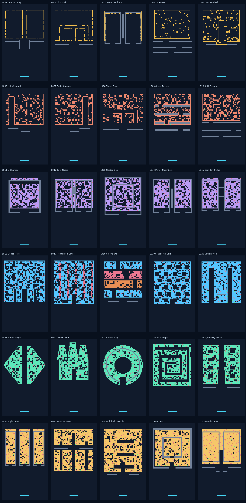

# 30 关逐关布局与制作交接（V1.3，地图未调整）

**编号：** MB-LVL-011｜**状态：** 可编辑资源与统计闭环；**尚未游戏内通关和真机验证**。

## 1. 设计资产与权威边界

30 关全部提供对应的 `levels-src/Lxxx.tmj`、`assets/levels/Lxxx.json`、`design/levels/Lxxx.png`，以及总览 [`all_30_levels.png`](../design/levels/all_30_levels.png)。这三份资源共用同一网格，不存在每关独立的物理解释。`manifest.json` 包含每关名称、设计意图、实际砖量、墙数、道具数和理论上限。

**V1.2 纠偏：** 前四关从原 4,000 量级改为 320–520 目标砖，以配合单球入门；后续关卡逐步增加 B 道具和密度。保留中央通道、双腔、分叉等核心造型；数据是设计候选版本，试玩反馈可能继续修订。

## 2. 统一尺寸与层规范

| 属性 | 值 |
|---|---|
| 世界 | `24×40`，左上原点，y 向下 |
| 网格 | `96×160`，格长 `0.25` |
| 编辑 tile | `8×8 px` Tiled 源地图；生成运行时格是 0.25 世界单位 |
| 顶部砖块范围 | 允许在行 `0..113`，当前内容通常在 `10..113` |
| 控制区 | 行 `114..159` 不含砖／墙 |
| 出生／挡板 | 球 `(12,37.65)`，挡板 `(12,38.0)` |
| 碰撞类型 | `.123#B`，含义见 [`04_LEVEL_DATA_SPEC.md`](04_LEVEL_DATA_SPEC.md) |
| +3 奖励 | B 砖击破掉落，接到才增加 3 球；无法自动增球 |

## 3. 全部关卡规格和资源索引

| 关卡 | 结构定位 | 目标砖 | 2HP / 3HP | 固定墙 | B | 本生命内理论上限¹ |
|---|---|---:|---:|---:|---:|---:|
| [**L001**](../design/levels/L001.png) 中央通道 | 中央竖直空隙把上部密集砖阵分为两翼；底部导流墙留入口 | 320 | 0 / 0 | 200 | 0 | 1 |
| [**L002**](../design/levels/L002.png) 首次分叉 | 从中央入口进入左、右支路，练习挡板控角 | 380 | 0 / 0 | 116 | 0 | 1 |
| [**L003**](../design/levels/L003.png) 双腔室 | 两组U形固定墙围出并列腔室，打通内侧砖阵 | 440 | 0 / 0 | 944 | 0 | 1 |
| [**L004**](../design/levels/L004.png) 窄门 | 错位横墙间留下通行缺口，练习细小入口 | 520 | 0 / 0 | 420 | 0 | 1 |
| [**L005**](../design/levels/L005.png) 首次增球 | 在易击中、易接住的区域提供首次+3道具 | 1,000 | 0 / 0 | 97 | 3 | 10 |
| [**L006**](../design/levels/L006.png) 左侧通道 | 左侧纵向入口绕过右侧高密砖区 | 1,250 | 0 / 0 | 82 | 4 | 13 |
| [**L007**](../design/levels/L007.png) 右侧通道 | 镜像右侧入口与局部耐久砖 | 1,450 | 72 / 0 | 84 | 5 | 16 |
| [**L008**](../design/levels/L008.png) 三岔路 | 中央竖井分为三条支路，对比弹跳路径 | 1,600 | 87 / 0 | 132 | 6 | 19 |
| [**L009**](../design/levels/L009.png) 错位隔板 | 交错隔板形成Z形通路，挡板要改变打入角度 | 1,700 | 87 / 0 | 1,024 | 7 | 22 |
| [**L010**](../design/levels/L010.png) 双层分流 | 两层横向隔板各有不同缺口 | 1,850 | 97 / 0 | 432 | 8 | 25 |
| [**L011**](../design/levels/L011.png) U形腔体 | 开口朝下的宽U形围墙围出高密区域 | 2,200 | 118 / 0 | 738 | 8 | 25 |
| [**L012**](../design/levels/L012.png) 双闸门 | 两个可进入的腔体，入口方向不同 | 2,400 | 134 / 0 | 824 | 9 | 28 |
| [**L013**](../design/levels/L013.png) 嵌套箱体 | 大小两层U形围合，逐层击破 | 2,650 | 153 / 0 | 920 | 10 | 31 |
| [**L014**](../design/levels/L014.png) 镜像腔室 | 左右镜像箱体，靠B砖增加左右覆盖 | 2,750 | 141 / 0 | 960 | 11 | 34 |
| [**L015**](../design/levels/L015.png) 腔室桥接 | 双腔间由横向狭道连接，形成二次反弹 | 3,000 | 158 / 0 | 784 | 12 | 37 |
| [**L016**](../design/levels/L016.png) 高密砖海 | 宽范围连续高密微砖区，底部提供入口 | 4,300 | 227 / 0 | 0 | 12 | 37 |
| [**L017**](../design/levels/L017.png) 强化纵道 | 条带耐久砖与普通砖交织，控制清除先后 | 4,700 | 1,067 / 0 | 0 | 14 | 43 |
| [**L018**](../design/levels/L018.png) 分层色带 | 多层耐久差异与多处间隙，强化视觉递进 | 3,500 | 959 / 906 | 96 | 16 | 49 |
| [**L019**](../design/levels/L019.png) 交错格阵 | 按区块错位挖空形成锯齿路径 | 4,200 | 218 / 0 | 0 | 18 | 55 |
| [**L020**](../design/levels/L020.png) 双竖井 | 两处竖井深入密集砖阵，配合B砖引出多球 | 4,800 | 248 / 0 | 36 | 20 | 61 |
| [**L021**](../design/levels/L021.png) 对称双翼 | 镜像展开的两侧翼形砖阵 | 3,000 | 157 / 0 | 0 | 16 | 49 |
| [**L022**](../design/levels/L022.png) 像素皇冠 | 皇冠形高密像素轮廓，内部有中轴通道 | 3,200 | 160 / 0 | 0 | 18 | 55 |
| [**L023**](../design/levels/L023.png) 缺口圆环 | 近似圆环与下部缺口形成内外反弹 | 3,400 | 178 / 0 | 396 | 20 | 61 |
| [**L024**](../design/levels/L024.png) 阶梯螺旋 | 正交阶梯构造方形螺旋空腔 | 3,700 | 196 / 0 | 0 | 22 | 67 |
| [**L025**](../design/levels/L025.png) 失衡对称 | 表面对称，局部开口让左右破坏节奏不同 | 3,800 | 191 / 100 | 108 | 24 | 73 |
| [**L026**](../design/levels/L026.png) 三核 | 三组相邻密砖区，墙体建立迂回路线 | 3,800 | 198 / 106 | 1,080 | 24 | 73 |
| [**L027**](../design/levels/L027.png) 双层迷宫 | 上、下砖阵由中央与两侧竖井相连 | 4,200 | 213 / 106 | 116 | 28 | 85 |
| [**L028**](../design/levels/L028.png) 多球级联 | 分区设置B砖形成逐步增长的多球过程 | 5,200 | 268 / 147 | 80 | 32 | 97 |
| [**L029**](../design/levels/L029.png) 堡垒 | 外环强化砖与内核密砖，利用下方缺口进入 | 4,300 | 219 / 117 | 1,380 | 36 | 109 |
| [**L030**](../design/levels/L030.png) 综合回路 | 双腔、分叉和通道合并成最终综合布局 | 5,000 | 255 / 134 | 864 | 40 | 121 |

¹ “理论上限”是假设所有 B 均接到且球未掉落时 `1 + B×3` 的数量；不代表可达成，也不代表 1024 引擎容量。

## 4. 三个视频参考关卡的对应关系

| 参考来源 | 本项目关卡 | 借鉴关系 | 注意事项 |
|---|---|---|---|
| `2119996452865007780` | L001 中央通道 | 黄色砖阵 + 中央纵向入口 | 单球教学版，不逐帧复刻原视频 |
| `2119996305334534265` | L002 首次分叉 | 横向支路 + 竖向隔板 | 明确玩家控制的反弹路线 |
| `2119996364327440609` | L003 双腔室 | 并列腔体 + 固定墙 | 结构概念相同、坐标由本项目定义 |

不依据视频猜测原游戏源码、精确物理参数或授权关系。

## 5. 关卡编辑与重新生成

见 [`04_LEVEL_DATA_SPEC.md §5`](04_LEVEL_DATA_SPEC.md)，按顺序更新 `.tmj` → JSON → `manifest.json` → PNG 并运行 source 对照与基本几何检查。`design/levels/` 中的图片是**当前资源直接渲染**，不应再使用 V1.1 旧截图作为 V1.2 关卡依据。

## 6. 各章节实现与验收关注

| 章节 | 关卡 | 设计核心 | 开发中必须实际检查 |
|---|---|---|---|
| A | L001–L005 | 单球入门 → 首次 +3 | 首球能碰到砖，L005 可接住道具，关卡合理时长 |
| B | L006–L010 | 单入口、岔路、错位隔板 | 玩家能够通过挡板角度选择分支 |
| C | L011–L015 | 双腔、嵌套、桥接 | 不被固定墙困住，球能进入目标区域 |
| D | L016–L020 | 高密度、加固纵道 | 球多时保持准确碰撞，HP 清除可感知 |
| E | L021–L025 | 对称图案、皇冠、圆环、螺旋 | 轮廓清晰且可清除目标，而不是只有视觉 |
| F | L026–L030 | 三核、双层迷宫、多球级联 | B 的分布合理、最终目标能正常打完 |

所有关卡的“必须通关一次并记录”是 T15 的内容验收，**不能拿 `geometry.py` 的检查结果代替**。

## 7. 数值平衡与真实测试

具体的逐关砖块统计、理论球数上限、首关纠偏动机、实测记录模板见 [`13_LEVEL_BALANCE.md`](13_LEVEL_BALANCE.md)。实际通关时长、道具拾取率和设备帧率尚未知；作为正常游戏开发验收，不设置独立长期技术研究项目。
